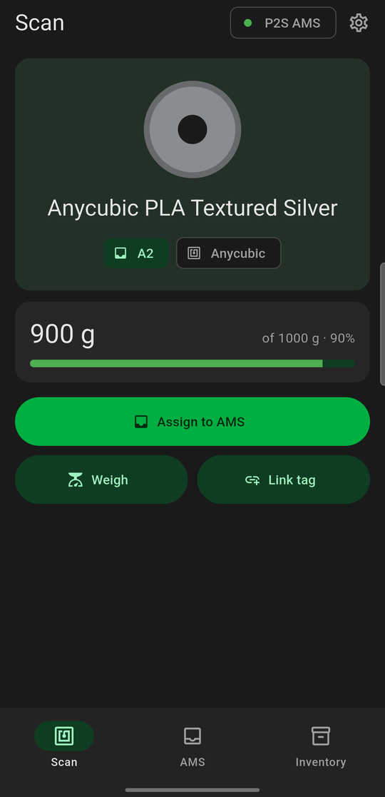
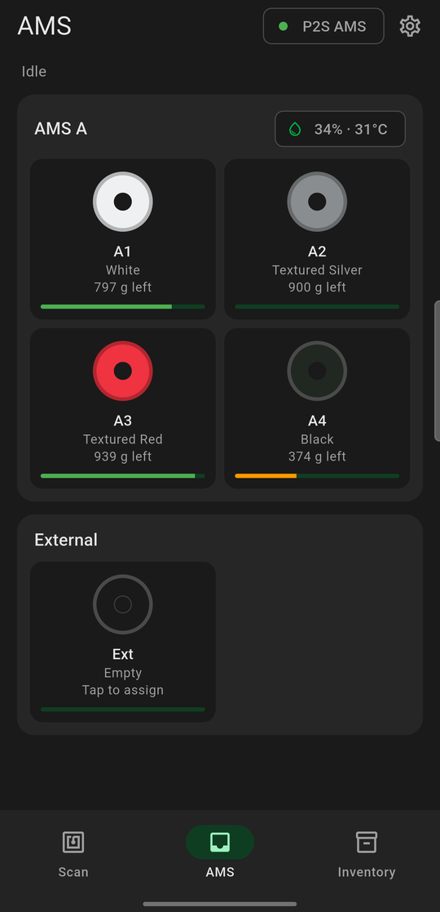
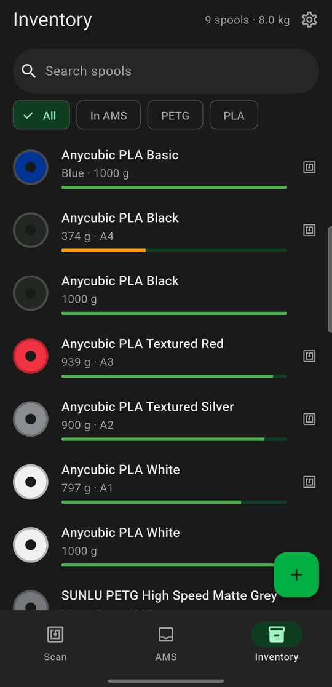

<p align="center">
  
</p>

<h1 align="center">SpoolBuddy for Android</h1>

<p align="center">
  Your phone as an NFC spool reader for <a href="https://github.com/maziggy/bambuddy">Bambuddy</a>,<br>
  or a complete filament inventory on its own.
</p>

<p align="center">
  
  &nbsp;
  
  &nbsp;
  
</p>

SpoolBuddy for Android is a Flutter port of [SpoolBuddy](https://github.com/macpit/spoolbuddy). Paired with Bambuddy, the phone takes the place of the Raspberry Pi kiosk: tap a spool's tag, see what's on it, and assign it to an AMS slot. Bambuddy keeps the inventory in its own database or in [Spoolman](https://github.com/Donkie/Spoolman).

Unpaired, the app is a standalone inventory that talks to Bambu Lab printers directly over the LAN.

## Highlights

- **Tap to identify.** Hold a spool to the phone to see its brand, colour, remaining filament and AMS slot.
- **Load to assign.** Press *Assign to AMS* and load the spool. The app watches the AMS and assigns the spool to whichever slot it goes into. *Assign manually* is there when you'd rather pick.
- **Spools with two tags.** Link both tags of a double-tagged spool to the same spool. With Spoolman 0.27 or newer, Bambuddy stores every tag, so either side scans to the right spool.
- **Reads the tag's own data.** New spools are pre-filled from the tag:

  | Tag | What it fills in |
  |---|---|
  | Bambu Lab RFID | Everything, including the tray UUID shared by both tags |
  | Anycubic ACE | Brand, material, colour, weight, nozzle and bed temperatures |
  | OpenSpool, OpenTag3D, OpenPrintTag, SpoolEase | What the format stores |

- **Writes tags.** Writes NTAG tags from a spool's page, or when Bambuddy asks for one.
- **Weigh by hand.** Enter the spool's total weight; the empty-spool weight is subtracted.
- **Feels like the kiosk.** Material 3 screens in the SpoolBuddy kiosk's colours, with a themed launcher icon.

## Requirements

- An Android phone with NFC.
- Bambu Lab tags are MIFARE Classic, which only phones with an NXP NFC chip can read. Many Pixel and some Samsung phones can't. Every other tag type works on any NFC phone.
- For companion mode: [Bambuddy](https://github.com/maziggy/bambuddy), reachable from the phone.
- For standalone mode: the phone and printer on the same network, with the printer in LAN mode.

## Install

Download the APK from the [Releases](../../releases) page and open it on your phone. Android asks you to allow installs from your browser or file manager the first time.

## Pair with Bambuddy

1. In Bambuddy, go to **Settings → API Keys** and create a key that can read and update the inventory.
2. In the app, open **Settings → Bambuddy companion**. Enter Bambuddy's address (for example `http://192.168.1.100:8000`), the API key and a name for the phone.
3. The phone registers with Bambuddy and shows up under **SpoolBuddy devices**. The app switches to the companion screens.

### Companion screens

| Screen | What it does |
|---|---|
| **Scan** | Tap a spool. A known spool shows its remaining filament and AMS slot, with *Assign to AMS*, *Weigh* and *Link tag*; tap the card for details. An unknown tag offers *Add spool*, pre-filled from the tag, or *Link to existing spool*, for the second tag of a spool you already have. |
| **AMS** | Every AMS unit and the external holder as slot tiles. Tap a slot to assign, change or unassign its spool. |
| **Inventory** | Search, filter by material or *In AMS*, and add spools without a tag with the **+** button. A spool's page adds *Link a tag* and *Write new tag*. |

The title bar shows the selected printer; tap it to switch. For anything else, such as filament presets, K-profiles or clearing the plate, use Bambuddy's web UI.

### How it works with Bambuddy

- While the app is open it sends a heartbeat every 10 seconds and listens for tags.
- Every tag is reported with its chip UID. For Bambu Lab tags the app also sends the tray UUID and raw blocks, the same as the Pi daemon.
- *Add spool* takes single print temperatures: from a tag's range, the low end for the nozzle and the high end for the bed. With Spoolman they're set on the spool's filament (`extruder_temp`, `bed_temp`) directly in Spoolman, at the address Bambuddy uses, because Bambuddy's Spoolman API has no temperature fields. With Bambuddy's own inventory the nozzle temperature is stored on the spool; it has no bed field.
- *Assign to AMS* polls the printer every 2 seconds and watches the AMS's spool-present state. That's why it also works for spools without a Bambu tag.

### Limitations

- **Foreground only.** Android only gives NFC to the app on screen, so Bambuddy shows the phone as offline while the app is in the background.
- **No tag-removed event.** A phone can't tell when a tag leaves, so "tag removed" is sent when the next tag is scanned.
- **No scale.** Weights are entered by hand. The Pi's remote commands (reboot, updates, diagnostics) don't apply to a phone.
- **Plain HTTP is allowed,** so the app can reach Bambuddy on a LAN over `http://`.
- **Anycubic tags** don't store a colour name or variant (such as "Textured"), so you type those in.

## Standalone mode

Without pairing, the app keeps its own inventory on the phone and connects to Bambu Lab printers over LAN MQTT (port 8883, LAN or Developer Mode):

- An inventory with search, material filters, archiving and weight tracking, using upstream's formulas.
- Live print status, AMS and AMS HT units with humidity and temperature, and tray contents with remaining %, K values and the active slot. Dual-nozzle printers (H2D) are supported.
- Slot assignment with `ams_filament_setting` and `extrusion_cali_sel`, K-profiles per slot, and re-reading RFID.
- Usage logging: when a print finishes, the AMS's remain % change is turned into grams and taken off the spool.
- Editable catalogs of empty-spool weights and colours.

Not ported yet: scale hardware, Bambu Cloud login and preset sync, printer auto-discovery, humidity history graphs and print cover images.

## Build from source

You need Flutter 3.47 (stable) and JDK 17.

```bash
flutter pub get
flutter test
flutter build apk --release
```

The APK is written to `build/app/outputs/flutter-apk/app-release.apk`. Without a signing key it's signed with the debug key.

To sign with your own key, create `android/key.properties`. It's ignored by git.

```properties
storeFile=/absolute/path/to/upload-keystore.jks
storePassword=…
keyAlias=upload
keyPassword=…
```

GitHub Actions builds, tests and signs the app on every push, and publishes a release for every `v*` tag. [docs/RELEASING.md](docs/RELEASING.md) explains how to set it up.

The launcher icons are generated by `python tool/make_icons.py`, which needs Pillow.

## Project layout

| Path | Contents |
|---|---|
| `lib/bambuddy/` | Bambuddy API client, companion device (heartbeats, tag reports, tag writes), inventory store |
| `lib/ui/companion/` | Companion screens: Scan, AMS, Inventory, spool page, Add spool |
| `lib/tags/` | Tag decoders and encoders: Bambu Lab, Anycubic, OpenSpool, OpenTag3D, OpenPrintTag, SpoolEase |
| `lib/nfc/` | Phone NFC reading and writing (`flutter_nfc_kit`) |
| `lib/data/`, `lib/printers/`, `lib/ui/` | Standalone mode: SQLite inventory, MQTT printer connection, screens |
| `tool/make_icons.py` | Draws the logo and launcher icons |
| `.github/workflows/build.yml` | Build, test, sign and release |

## Credits

- [SpoolBuddy](https://github.com/macpit/spoolbuddy) by MartinNYHC, MIT License. Tag formats, inventory logic and printer handling are ported from it.
- [Bambuddy](https://github.com/maziggy/bambuddy) by maziggy. This app uses its SpoolBuddy device API and inventory API.
- The Anycubic tag layout was read from Anycubic ACE RFID tags.

SpoolBuddy and Bambuddy are independent projects; this port isn't affiliated with them, Bambu Lab or Anycubic.
